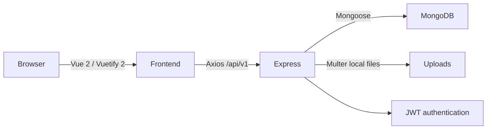

# ElectroHub architecture

## Runtime layout

- `frontend/src/views` owns page composition; reusable product, order and layout controls live under `components/`.
- Vuex modules hold authentication, catalog results and the per-account browser cart. API calls are isolated in `services/`.
- Express routes apply authentication and role middleware before controller actions. Controllers validate request data, call Mongoose models/utilities and return the shared `{ status, message, data }` envelope.
- MongoDB is the source of truth for products, stock, orders, customer-owned resources, coupons and reviews. Product images stay on local disk under `backend/uploads/products`.
- Docker Compose serves the Vue build through Nginx. Nginx forwards `/api/` and `/uploads/` to Express; MongoDB is available only on the local host port.

## Trust boundaries

- Public catalog reads use optional JWT. Protected APIs authenticate the current account from the Bearer token; admin/customer permissions are checked on the server.
- Checkout re-reads product prices and stock in MongoDB. Order line prices, coupon discounts and selected shipping address are snapshots.
- Stock checkout, cancellation, coupon redemption and manual stock adjustment use MongoDB transactions. A replica set or mongos is required.
- Review eligibility and order/customer ownership are checked in controllers from database records, never from client-supplied role claims alone.
- CSV output contains Order snapshots and IDs, not credentials or payment data. Spreadsheet formula prefixes are escaped.

## Transaction paths

### Checkout

`POST /orders` validates all requested product IDs/quantities, opens a session, atomically decrements each stock row, reserves the optional coupon, creates the Order snapshots and writes stock movements. Any failure aborts the session.

### Cancellation

Cancellation verifies the current state and owner/admin permission, updates the idempotency marker, restores stock, releases a coupon redemption once and writes movements inside one transaction.

### Admin stock adjustment

`POST /inventory/adjustments` applies a signed integer delta using an atomic condition that prevents negative stock. It writes actor, reason and before/after values in the same transaction. The legacy product update API remains compatible and records a generated audit reason when it changes stock.

## Local containers and CI

`docker-compose.yml` starts a single-node MongoDB replica set, backend and Nginx frontend. MongoDB data and uploads use named volumes. GitHub Actions starts an isolated MongoDB replica set for backend API/concurrency tests, then runs frontend component tests and a production build. CI uses test-only secrets and does not seed demo accounts.
